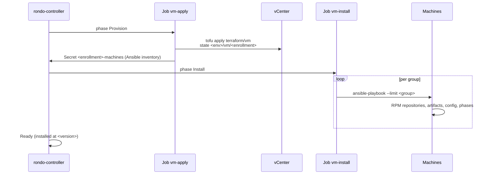

import { Aside, Tabs, TabItem } from '@astrojs/starlight/components';

`spec.vm` replaces `spec.chart`: **groups** of VMs cloned on a vSphere Target (`vm-apply`), then an **installer** or a **playbook** run on each group (`vm-install`).

To try it on the workstation, before any site: `rondo-sandbox deploy` then `component install` run these two Jobs on
containers that stand in for VMs (see [Test in the sandbox](/components/sandbox/#machine-components)).
`rondo-sandbox component new <directory> --archetype b` writes a starter machine component
(see [Start a component](/components/sandbox/#start-a-component)).



## Example

```yaml title="components/mft.yaml"
apiVersion: rondo.ouafeul.github.io/v1alpha1
kind: Component
metadata: {name: mft}
spec:
  vm:
    template: ${target.values.vmTemplate}          # default: the Target's vmTemplate value
    sizing: {cpu: 4, memoryMb: 8192, diskGb: 100}  # default for each group
    groups:
      - {name: gateway, replicas: 2}
      - name: db
        replicas: 1
        sizing: {cpu: 8, memoryMb: 16384, diskGb: 200}
        config: {ROLE: {value: primary}}
    rpmRepos:
      - {name: baseos, repo: rondo-rpms-local, path: el9/9.6/baseos, gpgKey: …}
    artifacts:
      - {repo: rondo-generic-local, provenance: component, path: components/mft/mft-3.2.0.tar.gz,
         digest: "sha256:…", extract: true}
    config:
      LISTEN_PORT: {number: 8443}
      PEERS: {list: [a, b]}
    installer:
      version: "3.2.0"
      configFile: mft.conf
      configFormat: shell            # shell | env | yaml | json
      secretsFile: secrets.env       # 0600, destroyed after the last phase
      secretsFrom:
        - secretRef: {name: mft}
          keys: [adminPassword]
      phases:
        - {name: prereqs, script: deploy/prereqs.sh}
        - {name: install, script: deploy/install.sh, args: [--non-interactive], timeout: 45m}
---
apiVersion: rondo.ouafeul.github.io/v1alpha1
kind: Enrollment
metadata: {name: mft}
spec:
  component: mft
  target: dc1                        # a vSphere Target, by name or role
```

## Machines

| Field | Rule | Effect |
|---|---|---|
| `groups[]` | 1 to 16; at least one with `replicas > 0` | a role, also an Ansible inventory group |
| `groups[].name` | RFC 1123, ≤ 32 | VMs `<component>-<group>-<n>` |
| `groups[].replicas` | 0 to 32, default 1 | |
| `groups[].ipsFromTargetValue` | default `vmIPs.<component>.<group>` | Target value that holds the IPs (JSON list or CSV) |
| `sizing`, `groups[].sizing` | `cpu` 1–64, `memoryMb ≥ 512`, `diskGb ≥ 10` | default 2 CPU / 4096 MB / 40 GB; disk = max(`diskGb`, template) |
| `template` | | default `${target.values.vmTemplate}` |

IPs are declared on the site side, in the vSphere Target's `componentValues`:

```yaml title="rondo.yaml"
targets:
  vsphere:
    - name: dc1
      componentValues:
        vmIPs.mft.gateway: '["10.0.1.11","10.0.1.12"]'
        vmIPs.mft.db: 10.0.1.21
```

The VMs are created in `<vmFolder>/<env>/<component>`, with RONDO's SSH key (Secret `rondo-vm-ssh`) for the `rondo` user. The tofu state is `<tofuStateRepository>/<env>/vm/<enrollment>`.

## Install

RONDO's playbook (`rondo-ansible`) runs, on each machine, in `/opt/rondo/<component>`:

1. the `rpmRepos` RPM repositories (`/etc/yum.repos.d/<name>.repo`, GPG checked by default);
2. the `artifacts`, downloaded from Artifactory, checked if `digest`, extracted if `extract`;
3. the `configFile` file, rendered from `config` (then `groups[].config`, which overrides it) in the `configFormat` format;
4. the `secretsFile` file, rendered from `secretsFrom`;
5. the `phases` in order, with `sudo` (`become`, default `true`); a failed phase stops the rest;
6. deletion of the secrets file.

<Tabs>
  <TabItem label="Installer">
    | Field | Effect |
    |---|---|
    | `version` | required; replays the install when it changes |
    | `script` **or** `phases[]` | one entry point, or up to 16 phases `{name, script, args, steps, skipSteps, timeout}` |
    | `args` | passed as is: include the non-interactive flag |
    | `steps`, `skipSteps` | passed with `stepsFlag` (default `--steps`) and `skipFlag` (default `--skip`) |
    | `configFlag`, `secretsFlag` | if set, pass the files' paths; otherwise the files are only dropped in place |
    | `timeout` | Go duration (`45m`); default: `policy.timeout` (10 min) − 60 s |
  </TabItem>
  <TabItem label="Component playbook">
    `spec.vm.ansible` replaces RONDO's content with the component's:

    ```yaml
    ansible:
      repo: rondo-generic-local
      path: components/mft/ansible-3.2.0.tar.gz
      playbook: site.yml          # default
      version: "3.2.0"
      extraVars: {mode: cluster}
    ```

    It is run group by group with the same `rondo_*` variables (inventory, config, secrets, repositories, artifacts).
  </TabItem>
</Tabs>

<Aside type="caution" title="No secrets in spec.vm">
`${secrets.*}` is refused in `template`, `config` and `groups[].config`: a secret goes through `installer.secretsFrom` and `secretsFile`. `${target.*}` tokens are allowed there.
</Aside>

## What reruns what

| Change | Job |
|---|---|
| template, sizes, groups, replicas, IPs | `vm-apply` only (see below) |
| `installer.version` / `ansible.version` | `vm-install` |
| config, repositories, artifacts, phases, playbook, value of a `secretsFrom` secret | `vm-install` |
| Enrollment deleted | `vm-destroy` (`tofu destroy`) |

<Aside type="caution" title="New machines">
After the first install, an infrastructure change (one more replica, a changed IP) only re-runs `vm-apply`: `vm-install` only replays on a version, configuration or secret change. To install new machines, publish a new `installer.version`.
</Aside>

A machine component is not probed by `rondo-probe`: `Ready` as soon as the install of the desired version has succeeded.
