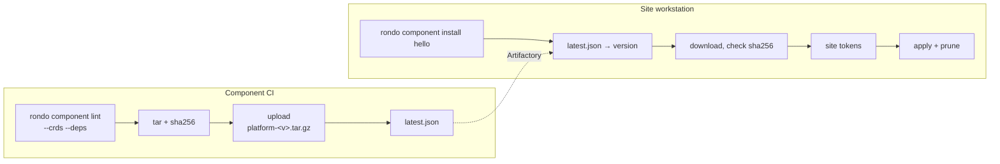

import { Aside, FileTree } from '@astrojs/starlight/components';
import CommandExplorer from '../../../components/CommandExplorer.astro';

The component's CI publishes the tree to the files repository of the artifact mirror, under `<name>/platform/`:

<FileTree>
- \<files repository\>/
  - hello/
    - platform/
      - platform-1.2.0.tar.gz tree content (components/, enrollments/)
      - platform-1.2.0.tar.gz.sha256
      - latest.json `{"version":"1.2.0"}`, written **last**
</FileTree>



`latest.json` comes last so that a site never sees a version whose archive is missing. Another channel (`--channel rc`) reads `<channel>.json`; `--version` bypasses the pointer.

## Validate before publishing

```bash
rondo component lint . --crds <rondo clone>/manifests/crds --deps dependencies.yaml
```

| Error | Warning |
|---|---|
| missing kind, `apiVersion` or name; duplicate | `status` field present |
| unknown field (with "did you mean"), type, enum, required | file outside `components/` or `enrollments/` |
| Component with both `chart` and `vm`, or neither | Component no Enrollment uses |
| Enrollment pointing to a missing Component | `dependsOn` pointing to a Component of another tree |
| `dependsOn` on itself or in a cycle | |
| `${target.*}` other than `name`, `server`, `values.<k>` | |
| `${secrets.k}` without `k` in `valuesFrom` / `secretsFrom` | |
| `${secrets.*}` in `spec.vm` | |

With `--deps`, the lint also checks that each chart (except `published: true`) is in `helm_charts` at the same version, that `artifacts` are mirrored (under `components/<name>/` for `provenance: component`), and that the `rpmRepos` are fed.

`rondo-sandbox check` adds to the lint, in seconds, what the site of the component's `rondo-sandbox.yaml` would refuse (one Target per Enrollment, the Target values read, release collisions), and `rondo-sandbox component install` installs the tree on workstation clusters before anything is published: see [Test in the sandbox](/components/sandbox/).

## Install, uninstall

<CommandExplorer only={['component-install', 'component-uninstall', 'lint']} />

The installed tree is recorded in the ConfigMap `rondo-component-<name>` (`version`, list of `Kind/Name`). On the next install, what is no longer in the tree is deleted: a removed Enrollment uninstalls its workload, and a removed Component is deleted only after the Enrollments removed with it are gone.

<Aside type="caution">A workstation that already has a version in its cache (`~/.rondo/cache/components/<name>/<version>/`) does not download it again: republishing under the same number never reaches it. Always publish a new version.</Aside>
