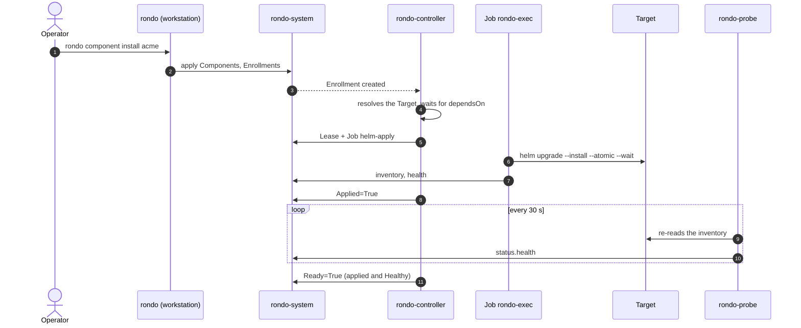
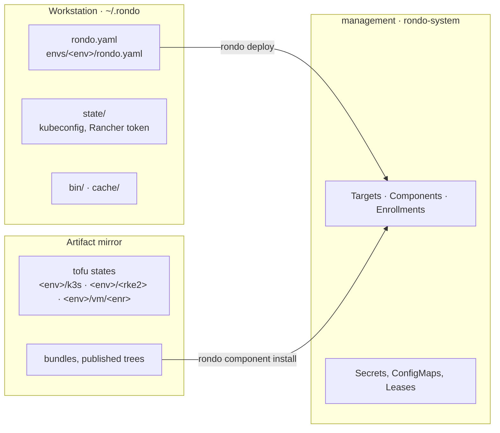

import { Aside } from '@astrojs/starlight/components';
import ArchitectureMap from '../../../components/ArchitectureMap.astro';
import BaseLayerGraph from '../../../components/BaseLayerGraph.astro';

<ArchitectureMap />

## The division of work

The **CLI** does what comes before the controller exists (VMs, k3s cluster, Rancher, operator) and writes objects. Everything that touches a target afterwards goes through a **Job** that the **controller** starts in `rondo-system`: one Job at a time per Enrollment, its logs available for 24 h.

## The management cluster

| Piece | Installed by | Role |
|---|---|---|
| HA k3s, 3 nodes | `rondo deploy` (tofu + SSH) | k3s's Traefik, `servicelb` disabled |
| MetalLB, cert-manager | helmfile | ingress IP, internal PKI (`cluster-ca-issuer`) |
| Rancher | helmfile | `rancher.<base>`, provisions the rke2 clusters |
| `rondo-controller` | CLI | reconciles Targets and Enrollments, starts the Jobs; leader election |
| `rondo-probe` | CLI | health of delivered objects, every 30 s (±20 %) |
| `rondo-dashboard` | CLI | `rondo.<base>`, read-only, refreshed every 5 s |
| CoreDNS | CLI | `rancher`/`rondo.<base>` and `*.<target or role>.<base>` |

The operator's three pods have 1 replica each, run as non-root (uid 65532) with a read-only file system. Their image is the one of the CLI version that ran `deploy`.

## Downstreams

One rke2 cluster per `targets.downstreams` entry, created by Rancher on vSphere (`terraform/rke2`): one machine per IP, control planes `etcd + control-plane`, workers `worker`. Each first receives its **base layer**, Enrollments `<component>-<target>` that the controller installs in `dependsOn` order:

<BaseLayerGraph />

## Host names

The management cluster's internal DNS, and the site's DNS, resolve:

| Name | To |
|---|---|
| `rancher.<base>`, `rondo.<base>` | management ingress IP |
| `<x>.<target name>.<base>` | the downstream's ingress IP |
| `<x>.<role>.<base>` | ingress IP of the downstream that carries the role |

A component that targets `monitoring` therefore exposes `grafana.monitoring.${INGRESS_BASE_DOMAIN}` without knowing the site.

## Where state lives

| Where | What | Rebuilt? |
|---|---|---|
| workstation, `~/.rondo/` | `rondo.yaml`, `state/` (kubeconfig, `rondo.state.json`), `bin/`, `cache/` | **no**: back it up |
| artifact mirror, tofu state base | tofu states of every stack | **no**: backed up with the mirror |
| artifact mirror, files repository | RONDO bundles, published trees | republished by CI and the mirror |
| management, `rondo-system` | RONDO objects, Secrets, ConfigMaps | yes: `rondo deploy` and `rondo component install` rewrite them |

The `rondo-system` objects are detailed in the [reference](/reference/rondo-system/).

<Aside type="tip" title="No git repository">
The desired state is versioned nowhere but in the published trees and `rondo.yaml`: it lives in the cluster, and the CLI rewrites it on every command.
</Aside>
