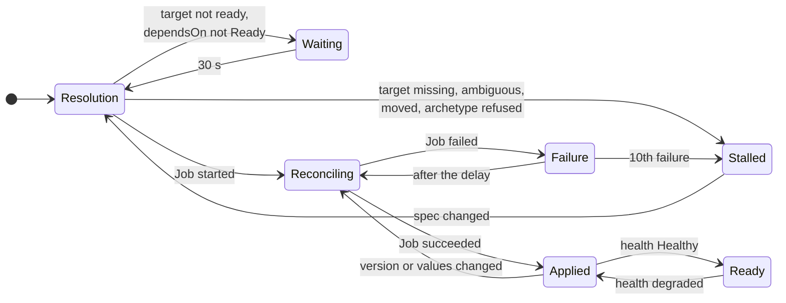
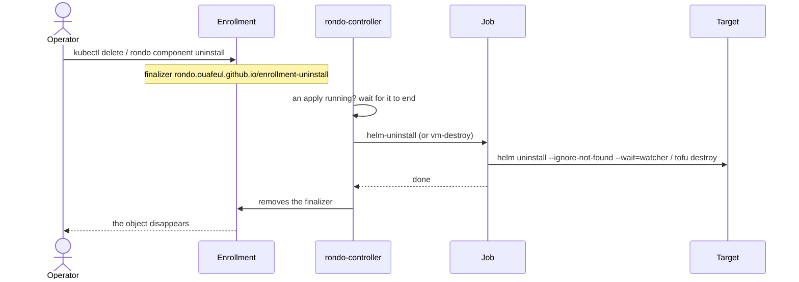

import { Aside, Tabs, TabItem } from '@astrojs/starlight/components';
import BackoffChart from '../../../components/BackoffChart.astro';
import ReconcileGates from '../../../components/ReconcileGates.astro';

## One reconciliation

On every wake-up (creation, change, Job end, Target or Component changed, or delay elapsed), the controller goes through these gates in order and stops at the first closed one. Pick a scenario:

<ReconcileGates />

## Conditions



| Condition | `True` when | Reasons |
|---|---|---|
| `Reconciling` | a Job is running | `JobRunning` |
| `Applied` | the last Job succeeded | `Succeeded`, `Failed` |
| `Ready` | applied **and** health `Healthy` (chart); installed (machines) | `Succeeded`, `Progressing`, `TargetUnreachable`, `DependencyPending`, `Failed` |
| `Stalled` | blocked until someone intervenes | `Failed`, `LeaseLost` |

The `Ready` message always says what to do: `kubectl -n rondo-system get enrollments -o wide` shows it.

## What starts a Job again

The controller compares the desired state with what the last successful Job applied:

<Tabs>
  <TabItem label="Chart">
    | Compared | With |
    |---|---|
    | the Component's `spec.chart.version` | `status.appliedChartVersion` |
    | hash of the merged values, `${target.*}` tokens resolved | `status.appliedValuesHash` |

    `${secrets.*}` enter the hash **as tokens**: changing a Secret's value starts nothing. To apply again, clear the hash:

    ```bash
    kubectl -n rondo-system patch enrollment <name> --subresource=status --type=merge \
      -p '{"status":{"appliedValuesHash":""}}'
    ```
  </TabItem>
  <TabItem label="Machines">
    | Phase | Run again if | Job |
    |---|---|---|
    | `Provision` | template, sizes, groups, replicas, IPs or the target's `vmTemplate` change; or the machine inventory is missing | `vm-apply` |
    | `Install` | `installer.version` (or `ansible.version`) changes; or config, RPM repositories, artifacts, phases, playbook, **secret values** (`secretsFrom`) change | `vm-install` |

    A machine component therefore replays its installer when a Secret it reads changes.
  </TabItem>
</Tabs>

## Retries

A Job has `backoffLimit: 0`: it succeeds or fails once. The controller counts consecutive failures, doubles the retry delay, and stops at the tenth.

<BackoffChart />

A `spec` change resets the counter to 0 and clears `Stalled`. Without a change:

```bash
kubectl -n rondo-system patch enrollment <name> --subresource=status --type=merge \
  -p '{"status":{"consecutiveFailures":0}}'
```

`status.history` keeps the last 5 attempts (Job, version, start, end, result, cause).

## Health

Every 30 s (±20 %), `rondo-probe` re-reads each object of `status.inventory` on its target and publishes `status.health` and `status.healthMessage`. The `helm-apply` Job also publishes a first assessment when it ends.

| Kind | Healthy | Progressing | Degraded |
|---|---|---|---|
| Deployment, StatefulSet | replicas ready, generation observed, or 0 replicas | otherwise | |
| DaemonSet | `numberReady ≥ desired` | otherwise, or no pod scheduled | |
| Job | `Complete` | otherwise | `Failed` |
| Pod | `Running`, `Succeeded` | `Pending` | `Failed` |
| PersistentVolumeClaim | `Bound` | `Pending` | `Lost` |
| Certificate, Issuer, ClusterIssuer, Target, Enrollment | `Ready=True` | `Ready=Unknown` | `Ready=False` |
| ConfigMap, Secret, Service, RBAC, Ingress, CRD, StorageClass, IngressRoute… | present | | |
| object missing from the cluster | | | **always** |
| other kind | the Component's `spec.health` rule, else `Ready`, else `Unknown` | | |

The Enrollment takes the worst: **Degraded > Unknown > Progressing > Healthy**, and the message names the faulty objects. Machine components are not probed.

<Aside type="tip">A custom kind without a `Ready` condition stays `Unknown`: declare it in the Component's [`spec.health`](/components/chart/#health).</Aside>

## Mutual exclusion

Before each Job, the controller takes a `coordination.k8s.io/Lease` named `rondo-lock-enrollment-<name>`, lasting the Job timeout + 2 min, renewed every 15 s while the Job runs. A Job already alive for the Enrollment is always found before a second one is started. If the lease is lost during a Job, the Enrollment becomes `Stalled` (`LeaseLost`).

## Uninstall



- The object disappears only once the uninstall Job has finished.
- A deletion during an apply waits for the apply to end, then uninstalls.
- An Enrollment that was never resolved disappears without a Job.
- The uninstall Job is built from the Component: it must exist until the Enrollment is gone. `rondo component uninstall` (and the prune of `rondo component install`) therefore deletes the Enrollments, waits until they are gone, then deletes the Components. A manual `kubectl delete` must follow the same order.
- If `helm-uninstall` fails, the finalizer is removed **anyway**: the release may remain on the target (see [Troubleshooting](/operations/troubleshooting/)).
