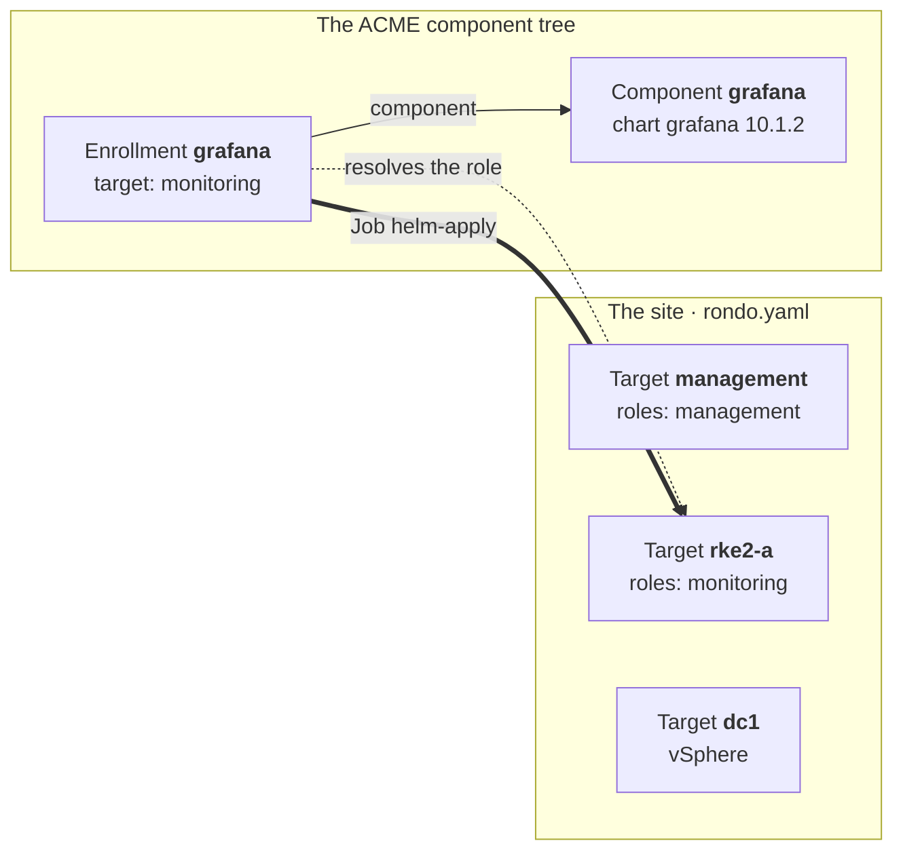
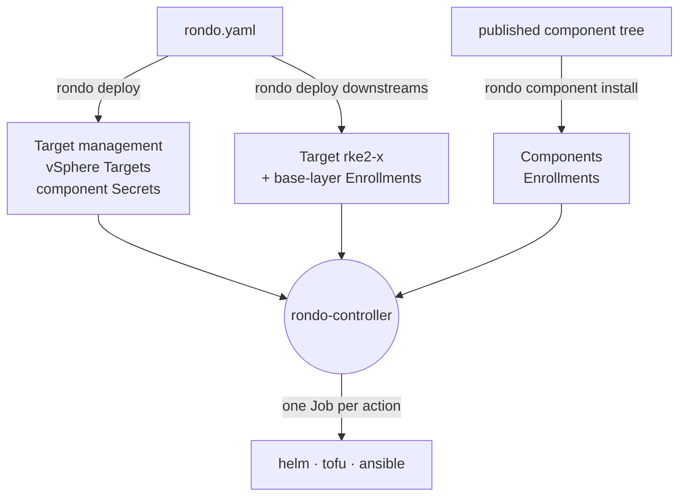

import { Aside, Card, CardGrid } from '@astrojs/starlight/components';
import TargetResolver from '../../../components/TargetResolver.astro';

RONDO installs **components** on **targets**. Three objects, group `rondo.ouafeul.github.io/v1alpha1`, all in `rondo-system`:

<CardGrid>
  <Card title="Component · what" icon="puzzle">
    A Helm chart, **or** vSphere machines and their installer. Written by the component's tree.
  </Card>
  <Card title="Target · where" icon="laptop">
    A Kubernetes cluster (k3s, rke2) **or** a vSphere placement. Written by the CLI from `rondo.yaml`.
  </Card>
  <Card title="Enrollment · this component on this target" icon="rocket">
    The only object that triggers an action. Written by the component's tree, or by `rondo deploy downstreams`.
  </Card>
</CardGrid>

## One target, by name or by role

An Enrollment's `spec.target` designates **exactly one** Target: by its name, or by one of its `spec.roles`. Roles decouple a component from the site: ACME targets `monitoring`, and each site decides which cluster carries that role.

| Case | Effect |
|---|---|
| one Target matches | `status.resolvedTarget` is set, **for good** |
| none | `Stalled`: `no Target has the name or role "x"` |
| several | `Stalled`: `"x" matches several Targets (…)` |
| the role moved to another target since | `Stalled`: `"x" resolved to a and now resolves to b` |
| archetype refused | `Stalled`: a Kubernetes Target only takes charts, a vSphere Target only machines |

Try it:

<TargetResolver />

<Aside type="caution" title="The resolved target never moves">
To move a component: move the role in `rondo.yaml`, **delete** the Enrollment (which uninstalls it from the old target), then create it again (`rondo component install`). See [Add, move](/operations/day-to-day/#add-move).
</Aside>

## The `management` role

The management cluster is a Target `management`, `inCluster: true`: the controller reaches it with its own ServiceAccount, without a kubeconfig. It carries the reserved role `management`, and only it: a component targets it with `target: management` whatever the site. The name and role `management` are refused everywhere else in `rondo.yaml`.

## Two archetypes

| | `spec.chart` | `spec.vm` |
|---|---|---|
| delivers | an OCI Helm chart, exact version | groups of cloned VMs + an installer or a playbook |
| on a Target | `kubernetes` (management or rke2) | `vsphere` |
| Jobs | `helm-apply`, `helm-uninstall` | `vm-apply`, `vm-install`, `vm-destroy` |
| health | probed by `rondo-probe` | not probed: `Ready` as soon as the install has run |
| guide | [Chart component](/components/chart/) | [Machine component](/components/machines/) |

A Component declares **exactly one** of the two (a CEL rule of the CRD); a chart also requires `spec.namespace`.

## Who writes what

The desired state goes through no git repository: it lives in `rondo-system`, and the CLI rewrites it. Targets belong to the site; a component tree never publishes one.
