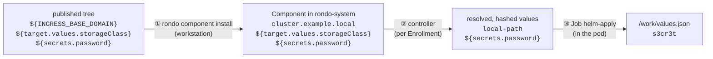
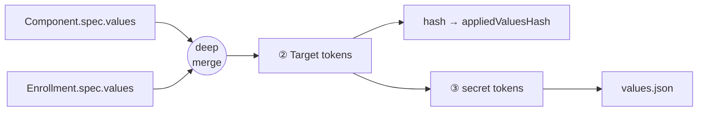

import { Aside } from '@astrojs/starlight/components';
import TokenPlayground from '../../../components/TokenPlayground.astro';

A component tree does not know the site. It leaves **tokens** that three actors replace, each in turn:

| | Tokens | Resolved by | Source | Unknown or empty |
|---|---|---|---|---|
| ① | the [site tokens](#site-tokens): `${OCI_REGISTRY}`, `${CHARTS_OCI}`, `${FILES_URL}`… | the CLI, in the tree's `.yaml/.yml/.json` files | `rondo.yaml` | the tree is refused: `unknown placeholders` |
| ② | `${target.name}`, `${target.server}`, `${target.values.<key>}` | the controller, for each Enrollment | the resolved Target | `unknown substitution token(s)`, with the list of available keys |
| ③ | `${secrets.<key>}` | the Job, at the last moment | the Component's and Enrollment's `valuesFrom`, read in `rondo-system` | the Job fails |

A secret is therefore never written to a Component, an Enrollment or a status: only to the pod's `/work/values.json` (0600), for the duration of `helm upgrade`.

<TokenPlayground />

## Site tokens

The artifact mirror of `rondo.yaml` (`artifacts`), whatever its preset, resolves to these tokens; a component names the mirror only through them.

| Token | Value | `preset: generic` | `preset: artifactory` |
|---|---|---|---|
| `${OCI_REGISTRY}` | registry authority, `host[:port]` | `oci.registry` | host of `artifactory.url` |
| `${IMAGES_REPOSITORY}` | repository of the images: `${OCI_REGISTRY}/${IMAGES_REPOSITORY}/<image>` | `oci.repository` (`rondo`) | `artifactory.repositories.docker` (`rondo-docker-local`) |
| `${CHARTS_REPOSITORY}` | repository of the Helm charts | `oci.chartsRepository` (`<oci.repository>/charts`) | `artifactory.repositories.helm` (`rondo-helm-local`) |
| `${CHARTS_OCI}` | `oci://${OCI_REGISTRY}/${CHARTS_REPOSITORY}`: a chart is `${CHARTS_OCI}/<chart>` | derived | derived |
| `${FILES_URL}` | root of the file server, without a trailing `/` | `files.url` | `artifactory.url` |
| `${FILES_REPOSITORY}` | path of the files under the root: `${FILES_URL}/${FILES_REPOSITORY}/<path>` | `files.repository` (`rondo`) | `artifactory.repositories.generic` (`rondo-generic-local`) |
| `${RPM_REPOSITORY}` | RPM repository of the site, under `${FILES_URL}`; empty without one, and a tree that uses it is refused | `rpm.repository` | `artifactory.repositories.rpm` |
| `${INGRESS_BASE_DOMAIN}` | base domain of the ingresses | `ingressBaseDomain` | `ingressBaseDomain` |

Defaults in parentheses. The same names, without `${}`, are in the environment of the tools the CLI runs (helmfile, OpenTofu).

## Target values

Every Target receives values computed by the CLI; `componentValues` in `rondo.yaml` adds to them **and overrides them**.

| Key | Management | rke2 | vSphere |
|---|---|---|---|
| `ingressIP` | `targets.management.ingressLoadBalancerIp` | `rke2.ingressLoadBalancerIp` | |
| `imageRegistry` | images prefix of the mirror, e.g. `<oci.registry>/<oci.repository>` | `rke2.registryHost`, else the rke2 system registry of the mirror | |
| `mirrorCA` | PEM of `artifacts.caCertificateFile`, empty without one | same | |
| `storageClass` | `local-path` | `local-path` | |
| `vmTemplate` | | | `targets.vsphere[].vmTemplate` |
| `sshUser` | | | `rondo` |
| `vmIPs.<component>.<group>` | | | to declare in `componentValues` |

The downstream base layer also puts the mirror CA in the Secret `mirror-ca` (key `ca.crt`) of each namespace listed in its `mirrorCA.namespaces`. The Secret always exists, so a component can mount it unconditionally; `ca.crt` is empty when the mirror's certificate is publicly trusted, so test that it is non-empty (`[ -s … ]`) before passing it to a client.

<Aside type="caution" title="Two registry forms">
`imageRegistry` is a path on the management cluster (`registry.example.local/rondo`) and the rke2 system registry on rke2: the registry itself (`registry.example.local`, the nodes rewrite the paths), or with `preset: artifactory` a subdomain (`rondo-docker-local.artifactory.example.local`). A chart must use it as is, without rebuilding the host.
</Aside>

## Merging values

- Maps merge key by key; the Enrollment wins.
- A list or a scalar from the Enrollment **replaces** the Component's.
- The Component's and Enrollment's `valuesFrom` add up. Each source is a `secretRef` or a `configMapRef` with its `keys` list (an empty list is refused).
- Without any `valuesFrom`, `${secrets.*}` stay as they are in `values.json`.

## Machine components

`spec.vm` accepts `${target.*}` tokens (template, config, groups), but **not** `${secrets.*}`: an install's secrets go through `installer.secretsFrom` and the `secretsFile` file. See [Machine component](/components/machines/).
