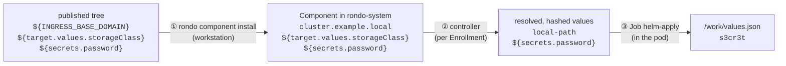
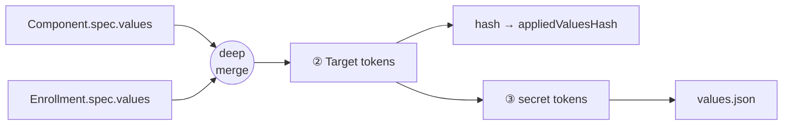

import { Aside } from '@astrojs/starlight/components';
import TokenPlayground from '../../../components/TokenPlayground.astro';

A component tree does not know the site. It leaves **tokens** that three actors replace, each in turn:

| | Tokens | Resolved by | Source | Unknown or empty |
|---|---|---|---|---|
| ① | `${REGISTRY_HOST}`, `${ARTIFACTORY_URL}`, `${ARTIFACTORY_HELM_REPO}`, `${ARTIFACTORY_DOCKER_REPO}`, `${ARTIFACTORY_GENERIC_REPO}`, `${ARTIFACTORY_RPM_REPO}`, `${INGRESS_BASE_DOMAIN}` | the CLI, in the tree's `.yaml/.yml/.json` files | `rondo.yaml` | the tree is refused: `unknown placeholders` |
| ② | `${target.name}`, `${target.server}`, `${target.values.<key>}` | the controller, for each Enrollment | the resolved Target | `unknown substitution token(s)`, with the list of available keys |
| ③ | `${secrets.<key>}` | the Job, at the last moment | the Component's and Enrollment's `valuesFrom`, read in `rondo-system` | the Job fails |

A secret is therefore never written to a Component, an Enrollment or a status: only to the pod's `/work/values.json` (0600), for the duration of `helm upgrade`.

<TokenPlayground />

## Target values

Every Target receives values computed by the CLI; `componentValues` in `rondo.yaml` adds to them **and overrides them**.

| Key | Management | rke2 | vSphere |
|---|---|---|---|
| `ingressIP` | `targets.management.ingressLoadBalancerIp` | `rke2.ingressLoadBalancerIp` | |
| `imageRegistry` | `<Artifactory host>/<dockerRepository>` | `rke2.registryHost`, else `<dockerRepository>.<Artifactory host>` | |
| `artifactoryCA` | PEM of `caCertificateFile` | same | |
| `storageClass` | `local-path` | `local-path` | |
| `vmTemplate` | | | `targets.vsphere[].vmTemplate` |
| `sshUser` | | | `rondo` |
| `vmIPs.<component>.<group>` | | | to declare in `componentValues` |

<Aside type="caution" title="Two registry forms">
`imageRegistry` is a path on the management cluster (`artifactory.example.local/rondo-docker-local`) and a subdomain on rke2 (`rondo-docker-local.artifactory.example.local`). A chart must use it as is, without rebuilding the host.
</Aside>

## Merging values

- Maps merge key by key; the Enrollment wins.
- A list or a scalar from the Enrollment **replaces** the Component's.
- The Component's and Enrollment's `valuesFrom` add up. Each source is a `secretRef` or a `configMapRef` with its `keys` list (an empty list is refused).
- Without any `valuesFrom`, `${secrets.*}` stay as they are in `values.json`.

## Machine components

`spec.vm` accepts `${target.*}` tokens (template, config, groups), but **not** `${secrets.*}`: an install's secrets go through `installer.secretsFrom` and the `secretsFile` file. See [Machine component](/components/machines/).
