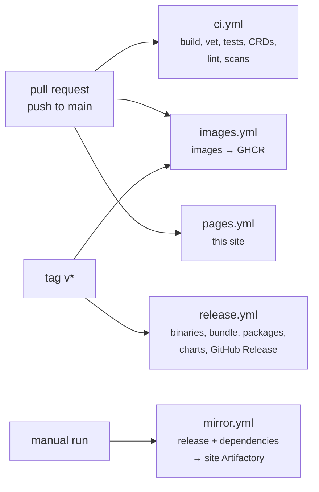

import { Aside, Steps } from '@astrojs/starlight/components';

## Workflows

CI runs on GitHub Actions, in `.github/workflows/`:

| Workflow | Trigger | Does |
|---|---|---|
| `ci.yml` | pull request, push to `main` | Go build, vet and tests (envtest), CRD generation check, lint of the platform tree, CI script checks, security scans |
| `images.yml` | push to `main`, tag `v*` | builds `rondo-controller`, `rondo-toolbox`, `rondo-component-toolbox`, `rondo-sandbox-machine` and pushes them to `ghcr.io/ouafeul/` |
| `release.yml` | tag `v*` | builds the release files, pushes the `apps/` charts to `oci://ghcr.io/ouafeul/charts`, and creates the GitHub Release with the tag's `CHANGELOG.md` section |
| `pages.yml` | push to `main` touching `docs/` | builds this site and deploys it to GitHub Pages |
| `mirror.yml` | manual (`workflow_dispatch`) | copies a release and the dependencies into an air-gap site's Artifactory |

## What a release publishes

| Artifact | Where |
|---|---|
| `rondo-linux-amd64`, `rondo-sandbox-linux-amd64`, `install.sh`, `rondo.yaml.example` | GitHub Release assets |
| `iac.tar.gz` + `.sha256` (IaC bundle) | GitHub Release assets |
| `vm.tar.gz` (tofu module of machines), `rondo-ansible.tar.gz` (machine playbook) | GitHub Release assets |
| `rondo-<ver>.x86_64.rpm` (`v1.2.3-rc.1` → `1.2.3~rc.1`) | GitHub Release assets |
| `rondo-sandbox-<ver>.x86_64.rpm`, `rondo-sandbox_<ver>_amd64.deb` | GitHub Release assets |
| `stable.json` | GitHub Release assets, **only** for a strict `vX.Y.Z` tag |
| images `rondo-controller`, `rondo-toolbox`, `rondo-component-toolbox`, `rondo-sandbox-machine` | `ghcr.io/ouafeul/<image>:<version>` |
| charts of `apps/` | `oci://ghcr.io/ouafeul/charts/<chart>` |

The release notes are the tag's section of `CHANGELOG.md`.

## Air-gap mirror

A site has no Internet access: RONDO and everything it installs must be copied into the site's Artifactory, from a connected network. `mirror.yml` does it for a given version (or the same scripts run by hand from a connected machine that can reach the Artifactory):

| From | To |
|---|---|
| release assets: CLI, `install.sh`, `rondo.yaml.example`, IaC bundle | `rondo-generic-local/rondo/<tag>/` |
| `stable.json` | `rondo-generic-local/rondo/` (the CLI's `stable` channel) |
| `vm.tar.gz` | `rondo-generic-local/tofu-modules/vm/<tag>/` |
| `rondo-ansible.tar.gz` | `rondo-generic-local/ansible/rondo/<tag>/` |
| RPMs | `rondo-rpms-local` |
| deb | `rondo-deb-local` (distribution `stable`, component `main`) |
| GHCR images | `rondo-docker-local` |
| `oci://ghcr.io/ouafeul/charts` | `rondo-helm-local` |
| `manifests/dependencies.yaml`: binaries, tofu providers, charts, images (extracted from the charts of `helmfile.yaml`, `platform/` and `apps/`, plus the upstream Rancher and rke2 lists), RPMs | `rondo-generic-local`, `rondo-tofu-local`, `rondo-helm-local`, `rondo-docker-local`, `rondo-rpms-local` |

Each downloaded file is scanned before upload. `stable.json` is written **last**, so that a site never resolves a version whose files are missing.

<Aside type="tip">A component follows the same pattern: its CI publishes its tree, charts and images, and its `dependencies.yaml` says what the site must mirror. See [Publish](/components/publish/).</Aside>

## Cut a release

<Steps>

1. Update `CHANGELOG.md`: `[Unreleased]` becomes `[X.Y.Z] - YYYY-MM-DD`.
2. Commit `:bookmark: release: vX.Y.Z` through a pull request.
3. Annotated tag on `main`: `git tag -a vX.Y.Z -m "vX.Y.Z, description"`.
4. `git push origin vX.Y.Z`.
5. Check that `release.yml` and `images.yml` succeeded: the GitHub Release has its assets, the images and charts are on GHCR.
6. For air-gap sites, run `mirror.yml` for the new version.

</Steps>
