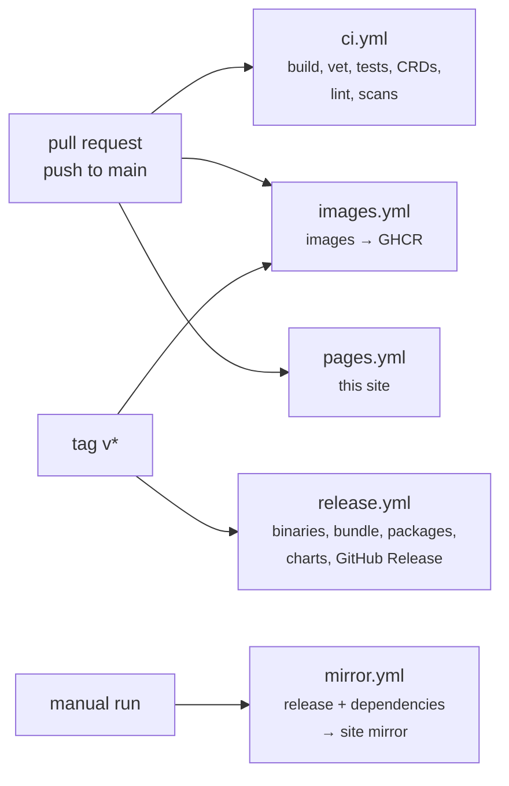

import { Aside, Steps } from '@astrojs/starlight/components';

## Workflows

CI runs on GitHub Actions, in `.github/workflows/`:



| Workflow | Trigger | Does |
|---|---|---|
| `ci.yml` | pull request, push to `main` | Go build, vet and tests (envtest), CRD generation check, lint of the platform tree, CI script checks, security scans |
| `images.yml` | push to `main`, tag `v*` | builds `rondo-controller`, `rondo-toolbox`, `rondo-component-toolbox`, `rondo-sandbox-machine` and pushes them to `ghcr.io/ouafeul/` |
| `release.yml` | tag `v*` | builds the release files, pushes the `apps/` charts to `oci://ghcr.io/ouafeul/charts`, and creates the GitHub Release with the tag's `CHANGELOG.md` section |
| `pages.yml` | push to `main` touching `docs/` | builds this site and deploys it to GitHub Pages |
| `mirror.yml` | manual (`workflow_dispatch`) | resolves, downloads and scans (ClamAV, Trivy) the dependencies, and copies them into an air-gap site's mirror |

## What a release publishes

| Artifact | Where |
|---|---|
| `rondo-linux-amd64`, `rondo-sandbox-linux-amd64`, `install.sh`, `rondo.yaml.example` | GitHub Release assets |
| `iac.tar.gz` + `.sha256` (IaC bundle) | GitHub Release assets |
| `vm.tar.gz` (tofu module of machines), `rondo-ansible.tar.gz` (machine playbook) | GitHub Release assets |
| `rondo-<ver>.x86_64.rpm` (`v1.2.3-rc.1` → `1.2.3~rc.1`) | GitHub Release assets |
| `rondo-sandbox-<ver>.x86_64.rpm`, `rondo-sandbox_<ver>_amd64.deb` | GitHub Release assets |
| `stable.json` | GitHub Release assets, **only** for a strict `vX.Y.Z` tag |
| images `rondo-controller`, `rondo-toolbox`, `rondo-component-toolbox`, `rondo-sandbox-machine` | `ghcr.io/ouafeul/<image>:<version>` |
| charts of `apps/` | `oci://ghcr.io/ouafeul/charts/<chart>` |

The release notes are the tag's section of `CHANGELOG.md`.

## Air-gap mirror

A site has no Internet access: RONDO and everything it installs must be copied into the site's mirror, from a connected network. The mirror is whatever the site runs, as long as it offers three services:

| Service | Any of | Flag | Environment |
|---|---|---|---|
| OCI registry | Harbor, GHCR, distribution, Artifactory, Nexus | `--oci-registry host[/prefix]` | `MIRROR_REGISTRY` |
| file server | any HTTP server accepting `PUT` (nginx with WebDAV, Artifactory, Nexus raw), an S3-compatible bucket (`s3://bucket/prefix`, needs `boto3`, optional), or a directory | `--files-url` | `MIRROR_FILES_URL` |
| RPM repository server | same as the file server | `--rpm-url` | `MIRROR_RPM_URL` |

Helm charts go to `<oci-registry>/charts`; `--charts-oci host/path` (`MIRROR_CHARTS_OCI`) sends them elsewhere, for example to a separate Helm repository of the registry (with the `artifactory` preset, `<host>/<repositories.helm>`). Credentials are `MIRROR_USER` / `MIRROR_PASSWORD`, and `MIRROR_CA_CERT` is the path of the PEM file of the CA that signs the mirror. OpenTofu providers go to a static network mirror under `--provider-mirror` (`MIRROR_PROVIDER_URL`, default `<files-url>/providers`). A file already on the server is not sent again: every upload is followed by a `<file>.sha256` sidecar, and a file whose sidecar matches is skipped.

### A release

`scripts/mirror-release.sh` (also a release asset) copies one RONDO release:

```bash
scripts/mirror-release.sh --version v1.0.0 \
  --registry registry.site/rondo --files-url https://files.site/mirror \
  --rpm-url https://rpm.site/rondo --channel stable
```

Add `--dry-run` to print the copy list first. `skopeo`, `helm`, `curl` and `git` are needed; `createrepo_c` builds the RPM `repodata/` when it is installed.

| From | To |
|---|---|
| release assets: CLI, `install.sh`, `rondo.yaml.example`, IaC bundle, checked against `SHA256SUMS` | `<files-url>/rondo/<tag>/` |
| `vm.tar.gz` | `<files-url>/tofu-modules/vm/<tag>/` |
| `rondo-ansible.tar.gz` | `<files-url>/ansible/rondo/<tag>/` |
| `--channel stable` | `<files-url>/rondo/stable.json` (the CLI's `stable` channel) |
| RPMs, deb | `<rpm-url>/rondo/<tag>/` |
| GHCR images `rondo-controller`, `rondo-toolbox`, `rondo-component-toolbox`, `rondo-sandbox-machine` | `<registry>/rondo-<name>:<tag>` |
| `oci://ghcr.io/ouafeul/charts` (the `apps/` charts of the tag) | `oci://<registry>/charts/<chart>` |

The channel file is written **last**, so that a site never resolves a version whose files are missing.

### The dependencies

`mirror.yml` copies what the release installs from third parties, from `manifests/dependencies.yaml`. Each entry has a `kind` (`file`, `grafana_plugin`, `provider`, `chart`, `image`, `rpm`) and a `path` relative to that kind's root, so the file says what is mirrored and the flags say where:

| Kind | Root | Mirrored by |
|---|---|---|
| `file`, `grafana_plugin` | `--files-url` | `download-deps.py` |
| `provider` | `--provider-mirror` | `download-deps.py`: `<host>/<namespace>/<type>/index.json`, `<version>.json` and the archives |
| `chart` | `<registry>/charts` | `download-deps.py` (`helm push`) |
| `image` (extracted from the charts of `helmfile.yaml.gotmpl`, `platform/` and `apps/`) | `<registry>` | `mirror-images.py` (`skopeo`) |
| `rpm` | `--rpm-url` | `mirror-rpms.py`, with `repodata/` built by `createrepo_c` |

The run also copies the upstream Rancher and rke2 image lists (`rancher-images.txt`, `rke2-images.linux-amd64.txt` of the pinned versions), registry to registry.

Each downloaded file is scanned with ClamAV, and the images and binaries with Trivy (SARIF report as an artifact; the run fails on a fixable CRITICAL or HIGH vulnerability only with the `fail_on_vulns` input). Secrets: `MIRROR_REGISTRY`, `MIRROR_FILES_URL`, `MIRROR_RPM_URL`, `MIRROR_USER`, `MIRROR_PASSWORD`, `MIRROR_CA_CERT`.

<Aside type="tip">A component follows the same pattern: its CI publishes its tree, charts and images, and its `dependencies.yaml` says what the site must mirror. See [Publish](/components/publish/).</Aside>

## Cut a release

<Steps>

1. Update `CHANGELOG.md`: `[Unreleased]` becomes `[X.Y.Z] - YYYY-MM-DD`.
2. Commit `:bookmark: release: vX.Y.Z` through a pull request.
3. Annotated tag on `main`: `git tag -a vX.Y.Z -m "vX.Y.Z, description"`.
4. `git push origin vX.Y.Z`.
5. Check that `release.yml` and `images.yml` succeeded: the GitHub Release has its assets, the images and charts are on GHCR.
6. For air-gap sites, run `scripts/mirror-release.sh --version vX.Y.Z` (and `mirror.yml` for the dependencies).

</Steps>
