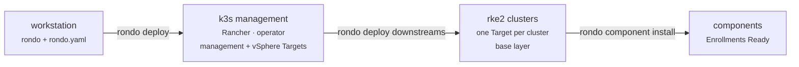

import { Aside, Steps, Tabs, TabItem } from '@astrojs/starlight/components';
import CommandExplorer from '../../../components/CommandExplorer.astro';

From a blank workstation to an installed component. Before starting, check the [prerequisites](/operations/prerequisites/): workstation, network, vCenter, DNS, and an artifact mirror that serves RONDO.



<Aside type="note">Time limits are set in code: 10 min per VM for cloud-init, 10 min for the operator to start, `policy.timeout` (10 min) per Job.</Aside>

<Steps>

1. **Install the CLI.**

   Every RONDO release is published on [GitHub Releases](https://github.com/ouafeul/rondo/releases): the `rondo-linux-amd64` binary, the `rondo` RPM, `install.sh` and `rondo.yaml.example`. On an air-gap site, the same files come from the site's artifact mirror once they are [mirrored](/contributing/release/#air-gap-mirror).

   <Tabs>
     <TabItem label="From GitHub">
       ```bash
       # RPM (pulls bash and openssh-clients, recommends sshpass)
       sudo dnf install -y https://github.com/ouafeul/rondo/releases/download/v<version>/rondo-<version>.x86_64.rpm
       # or the bare binary
       curl -fsSLo ~/.local/bin/rondo https://github.com/ouafeul/rondo/releases/latest/download/rondo-linux-amd64
       chmod +x ~/.local/bin/rondo
       ```
     </TabItem>
     <TabItem label="From the site's mirror">
       ```bash
       sudo dnf install -y rondo      # from the site's RPM repository
       # or, without RPM (<files>: the URL of RONDO's files on the mirror):
       curl -fsSL <files>/rondo/install.sh | RONDO_MIRROR_URL=<files> sh
       ```

       `install.sh` resolves the `stable` channel (`RONDO_MIRROR_URL`, `RONDO_CHANNEL`, `RONDO_VERSION` override it), puts the binary in `~/.rondo/bin` (linked from `~/.local/bin`) and runs `rondo init`.
     </TabItem>
   </Tabs>

2. **Describe the site.**

   ```bash
   rondo init                          # ~/.rondo/rondo.yaml, to fill in
   rondo init --env staging            # or a named environment
   ```

   Fill in the artifact mirror, the vSphere Target(s), the management cluster, the downstreams and the secrets. Each key is explained in the [rondo.yaml reference](/reference/rondo-yaml/). The template declares a `generic` mirror (any OCI registry and HTTP file server: `artifacts.oci`, `artifacts.files`, `artifacts.rpm`, `artifacts.tofu`); `rondo init --preset artifactory` writes one for a JFrog Artifactory instead, every endpoint derived from `artifacts.artifactory.url`. Put the mirror's CA at the path `artifacts.caCertificateFile`, or remove the key when its certificates are publicly trusted; remove `artifacts.username` and `secrets.mirrorPassword` for a mirror read anonymously.

3. **Check the plan, then deploy the management cluster.**

   ```bash
   rondo deploy --dry-run              # changes nothing; shows what would be done
   rondo deploy
   kubectl -n rondo-system get targets
   ```

   At the end, `https://rancher.<base>` and `https://rondo.<base>` (the dashboard) respond, and the `management` and vSphere Targets are `Ready`.

4. **Create the rke2 clusters.**

   ```bash
   rondo deploy downstreams            # every targets.downstreams entry, or name some
   kubectl -n rondo-system get enrollments -w
   ```

   Wait until each target's base layer (`metallb-<t>`, `cert-manager-<t>`, `traefik-<t>`…) is `Ready`.

5. **Install a component.**

   ```bash
   rondo component install acme
   kubectl -n rondo-system get enrollments
   ```

   The component targets roles (`monitoring`…): at least one target must carry them in `rondo.yaml`. See the [tutorial](/components/tutorial/).

</Steps>

## What each command does

Turn on `--dry-run` to see what simulation mode skips or replaces.

<CommandExplorer only={['deploy', 'deploy-downstreams', 'component-install']} />

## Next

- A command fails: fix the cause and **run the same command again**. See [Troubleshooting](/operations/troubleshooting/).
- To change something: edit `rondo.yaml` and run the command again, see [Day to day](/operations/day-to-day/).
- Back up `~/.rondo`: it is the only state that cannot be rebuilt.
