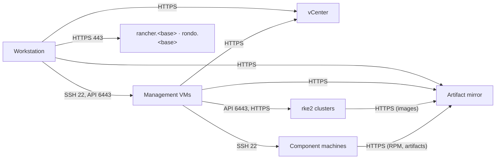

import { Aside } from '@astrojs/starlight/components';
import CapacityCalculator from '../../../components/CapacityCalculator.astro';

## Workstation

Linux x86_64 with, in the `PATH`:

| Tool | Package | Required by | Why |
|---|---|---|---|
| `ssh-keygen` | `openssh-clients` | every command | key pair for access to component machines |
| `bash` | `bash` | `rondo deploy` | runs `scripts/k3s-setup.sh` |
| `ssh`, `scp` | `openssh-clients` | `rondo deploy` | forms the k3s cluster, fetches the kubeconfig |
| `sshpass` | `sshpass` | `rondo deploy` | password SSH to fresh VMs; not in base RHEL: EPEL, or mirrored to the artifact mirror |

The `rondo` RPM pulls `bash` and `openssh-clients`, and recommends `sshpass`. The rest (`tofu`, `helm`, `helmfile`, `kubectl`, `yq`, `k9s`, `helm-diff` plugin) is downloaded from the artifact mirror into `~/.rondo/bin` at the bundle's versions.

<Aside type="caution">A tool already in `~/.rondo/bin` is not downloaded again, even if the bundle asks for another version: delete the binary to force the update.</Aside>

## Network

The management cluster's Jobs reach vCenter (component machines), the artifact mirror (charts, modules, tofu states) and the rke2 cluster APIs; the nodes pull their images from the mirror.

## vCenter

- The `vmFolder` of each vSphere Target exists. RONDO creates `<env>/MANAGEMENT` under it, one folder per rke2 cluster and one per machine component.
- The `vmTemplate` template has cloud-init. RONDO's cloud-init templates configure the **`ens32`** interface.
- The vCenter account can clone, and create folders and VMs in the datacenter.

## Site DNS

| Name | To |
|---|---|
| `rancher.<base>`, `rondo.<base>` | `targets.management.ingressLoadBalancerIp` |
| `*.<target>.<base>` and `*.<role>.<base>` | `rke2.ingressLoadBalancerIp` of each rke2 cluster |

The management cluster already resolves these names internally (CoreDNS); workstations and the site's other systems do not.

## Artifact mirror

The site has no Internet access, so an artifact mirror inside the site serves everything RONDO installs, declared under `artifacts:` in `rondo.yaml`. Two presets:

- **`generic`** (default): any OCI registry (Harbor, Zot, Nexus, a Distribution registry…) and any HTTP file server (nginx, an object store behind HTTPS…). Each endpoint is declared: `oci.registry`, `files.url`, `rpm`, `tofu.providerMirror`, `tofu.stateURL`.
- **`artifactory`**: a JFrog Artifactory; every endpoint derives from `artifactory.url` and the repository names.

Every repository is a path segment under its root, `<root>/<repository>/<path>`. The mirror holds:

| Content | `generic` | `artifactory` (default name) |
|---|---|---|
| RONDO release files (CLI, IaC bundle, `stable.json`, vm module, Ansible content), tools, published component trees | `<files.url>/<files.repository>` | `rondo-generic-local` |
| images: RONDO's own and those extracted from every chart | `<oci.registry>/<oci.repository>` | `rondo-docker-local` |
| Helm charts (OCI) | `oci://<oci.registry>/<oci.chartsRepository>` | `rondo-helm-local` |
| RPMs: `rondo`, OS repositories for component machines (optional) | `<rpm.url>/<rpm.repository>` | `artifactory.repositories.rpm` |
| OpenTofu providers (network mirror, a `tofu providers mirror` tree) | `tofu.providerMirror` | `rondo-tofu-local` |
| tofu states (HTTP backend, written) | `tofu.stateURL` | `rondo-tofu-state-local` |

They are fed from a connected network: RONDO releases come from [GitHub Releases](https://github.com/ouafeul/rondo/releases), images from `ghcr.io/ouafeul`, RONDO charts from `oci://ghcr.io/ouafeul/charts`, and third-party dependencies from `manifests/dependencies.yaml`. The copy scripts are not tied to Artifactory: they write to any OCI registry, any HTTP file server (or S3-compatible bucket) and any RPM repository server, given as `--oci-registry`, `--files-url` and `--rpm-url`; for Artifactory, pass the URLs of its repositories. See [Air-gap mirror](/contributing/release/#air-gap-mirror).

The service account (`artifacts.username`, `secrets.mirrorPassword`) reads every endpoint and writes the tofu states. The Jobs' providers authenticate on the provider mirror with `secrets.mirrorToken`; when it is empty, an Artifactory issues a token on each `rondo deploy` (without expiry, `artifactory.mirrorTokenLifetimeSeconds` empty, it needs an admin account) and a generic mirror is read without a token.

## Capacity

`rondo.yaml.example` in numbers, to adapt: the management cluster always has 3 nodes; an rke2 cluster has an **odd** number of control planes.

<CapacityCalculator />

<Aside type="note">`serverNodeSize.diskGb` is not applied to the management cluster: its VMs keep the template's disk.</Aside>
