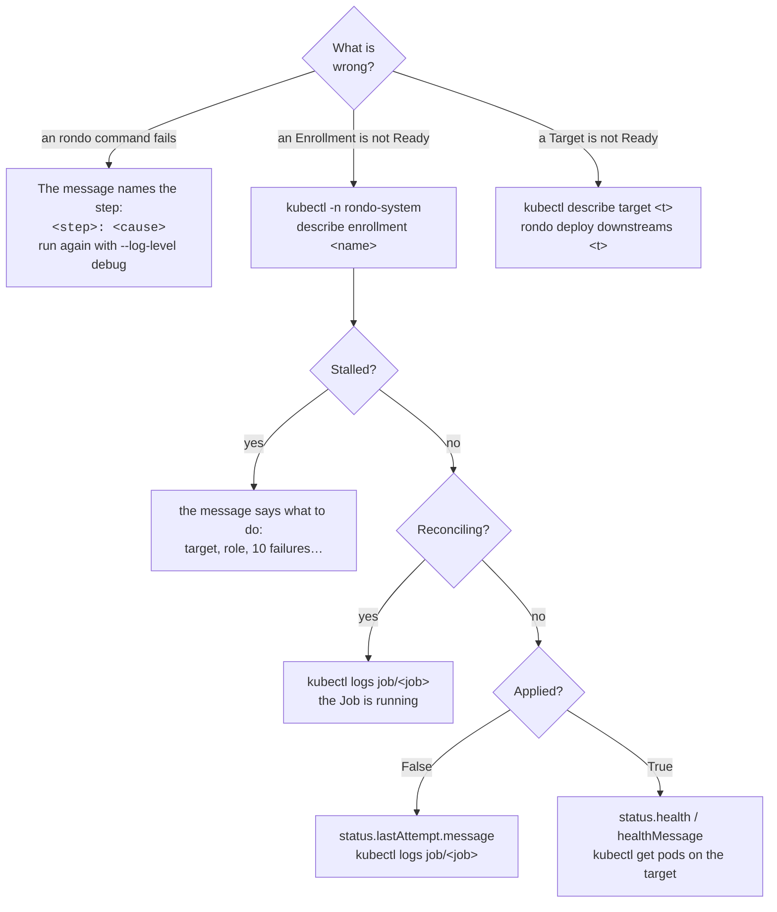

import ErrorCatalog from '../../../components/ErrorCatalog.astro';

## Where to look



```bash
kubectl -n rondo-system get targets,enrollments -o wide
kubectl -n rondo-system describe enrollment <name>       # conditions, lastAttempt, history
kubectl -n rondo-system logs job/<job>                   # 24 h after the Job ends
kubectl -n rondo-system logs deploy/rondo-controller      # reconciliation errors
```

The dashboard (`https://rondo.<base>`) shows the same, Job logs included.

## Catalog

<ErrorCatalog />

## Recovery actions

| Situation | Command |
|---|---|
| restart a `Stalled` Enrollment after 10 failures, without changing its spec | `kubectl -n rondo-system patch enrollment <name> --subresource=status --type=merge -p '{"status":{"consecutiveFailures":0}}'` |
| apply a chart again, unchanged | `kubectl -n rondo-system patch enrollment <name> --subresource=status --type=merge -p '{"status":{"appliedValuesHash":""}}'` |
| refresh a target's kubeconfig | `rondo deploy downstreams <target>` |
| rewrite Targets, Secrets, DNS | `rondo deploy` |
| see the commands the CLI runs | `--log-level debug`, or `--dry-run` to run nothing |
